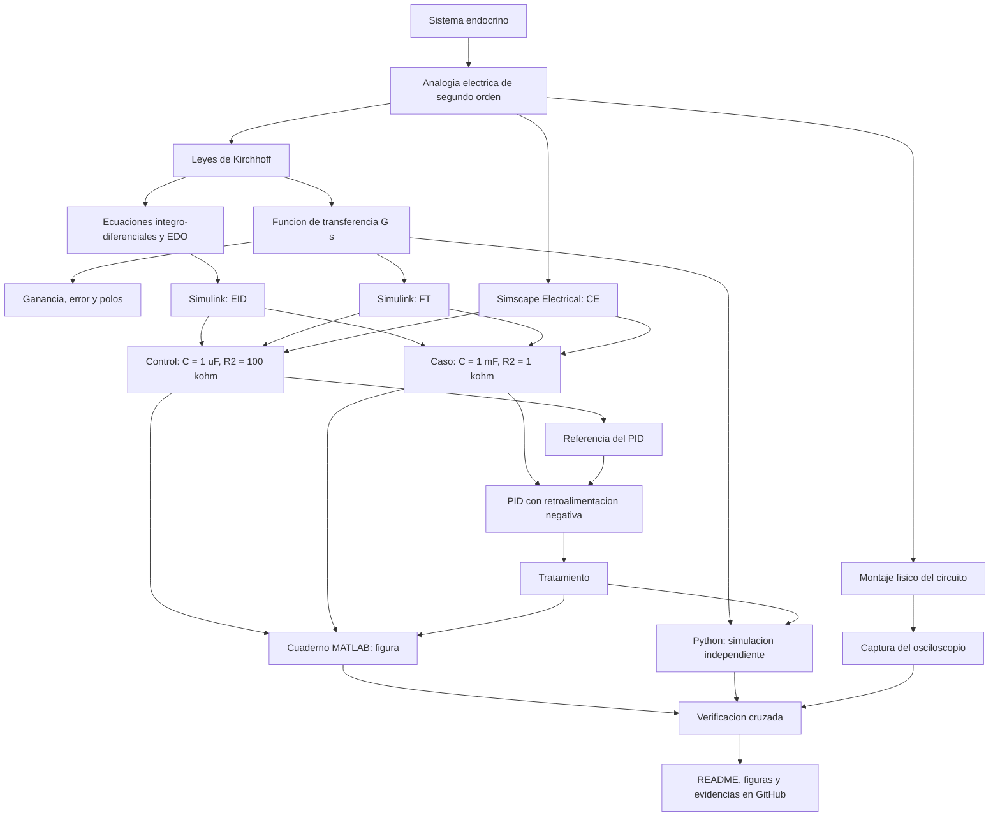

[](https://matlab.mathworks.com/open/github/v1?repo=mrAlan935/MSFP4)
# Práctica 4 — Modelado y control del sistema endocrino

Repositorio académico de la asignatura **Modelado de Sistemas Fisiológicos**, correspondiente al programa de **Ingeniería Biomédica** del Tecnológico Nacional de México / Instituto Tecnológico de Tijuana. Esta práctica integra analogía eléctrica de un sistema fisiológico, análisis matemático, estabilidad y error en estado estacionario, simulación en MATLAB/Simulink/Simscape, diseño de un controlador PID con retroalimentación negativa y reproducción independiente en Python.

El caso de estudio representa el **sistema endocrino** mediante un **circuito eléctrico de segundo orden** con una resistencia $R_1$, una inductancia $L$, un capacitor $C$ y una segunda resistencia $R_2$. Se comparan tres condiciones: **Control** (parámetros de referencia), **Caso** (parámetros alterados) y **Tratamiento** (el *Caso* regulado por un controlador PID cuya referencia es la respuesta del *Control*).

**Docente:** Dr. Paul Antonio Valle Trujillo  
**Correo:** paul.valle@tectijuana.edu.mx  
**Departamento:** Ingeniería Eléctrica y Electrónica  
**Institución:** Tecnológico Nacional de México / Instituto Tecnológico de Tijuana  
**Asignatura:** Modelado de Sistemas Fisiológicos  
**Programa:** Ingeniería Biomédica  
**Estudiante:** Obregon Maldonado Alan Yahir · 23212221 · l23212221@tectijuana.edu.mx

**Repositorio de la asignatura:** https://github.com/DrPaulValle/MSF-IBF1020  
**Sede:** Blvd. Alberto Limón Padilla s/n, Tijuana, C. P. 22454, B. C., México.

---

<a id="contenido"></a>
## Contenido

1. [Resumen](#resumen)
2. [Competencia y objetivos](#objetivos)
3. [Relación con el temario](#temario)
4. [Modelo físico y analogía eléctrica](#analogia)
5. [Formulación matemática](#modelo)
6. [Análisis temporal y de estabilidad](#analisis)
7. [Señal de entrada y condiciones de simulación](#senales)
8. [Implementación en MATLAB, Simulink y Simscape](#matlab)
9. [Control en lazo cerrado (PID)](#pid)
10. [Reproducción en Python](#python)
11. [Comprobación experimental con osciloscopio](#laboratorio)
12. [Resultados y verificación cruzada](#resultados)
13. [Flujo de trabajo](#flujo)
14. [Actividades del estudiante](#actividades)
15. [Estructura del repositorio](#estructura)
16. [Requisitos](#requisitos)
17. [Reproducibilidad y entregables](#reproducibilidad)
18. [Referencias](#referencias)

---

<a id="resumen"></a>
## Resumen

La práctica tiene como propósito **modelar, analizar, simular y controlar** un sistema endocrino simplificado, representado por un circuito de segundo orden con dos resistencias, una inductancia y una capacitancia. A partir de las leyes de Kirchhoff se obtiene el modelo en ecuaciones integro-diferenciales, su representación en variables de estado y la función de transferencia

$$
G(s)=\frac{V_s(s)}{V_e(s)}=\frac{Ls+R_2}{R_1CL\,s^2+(R_1R_2C+L)\,s+R_1+R_2}.
$$

Se calculan la ganancia en continua, el error en estado estacionario y la estabilidad mediante los polos. Las condiciones *Control* y *Caso* difieren en $C$ y $R_2$, de modo que el *Caso* responde con una ganancia final mucho menor ($0.5$ frente a $0.99$) y una dinámica más lenta. Para el *Tratamiento* se diseña un **controlador PID** con retroalimentación negativa unitaria, de modo que la salida del *Caso* siga a la del *Control*. Cada condición se implementa en Simulink de tres formas equivalentes (circuito de Simscape, ecuaciones integro-diferenciales y función de transferencia) y los resultados se reproducen con un cuaderno MATLAB y un script en Python. Además, se contrastan con una **medición en el circuito físico** mediante un osciloscopio digital, y se incluye como evidencia el desarrollo analítico manuscrito (mallas, ecuaciones integro-diferenciales, función de transferencia, error y estabilidad).

**Palabras clave:** sistema endocrino; circuito RLC de segundo orden; función de transferencia; controlador PID; retroalimentación negativa; MATLAB; Simulink; Simscape Electrical; Python; simulación *in silico*.

[Volver al contenido](#contenido)

---

<a id="objetivos"></a>
## Competencia y objetivos

### Competencia a desarrollar

Comprender los conceptos básicos de Ingeniería de Control, la respuesta temporal y los criterios de estabilidad mediante el modelado, la simulación y el control de un sistema fisiológico equivalente a un circuito eléctrico, empleando herramientas computacionales para su análisis y documentación.

### Objetivo general

Modelar el sistema endocrino mediante una analogía eléctrica de segundo orden, simularlo en las condiciones *Control* y *Caso*, y diseñar un controlador PID con retroalimentación que lleve la respuesta del *Caso* a la del *Control*, verificando los resultados con dos herramientas computacionales.

### Objetivos específicos

- Identificar la entrada, la salida y los elementos del circuito equivalente del sistema endocrino.
- Obtener las ecuaciones integro-diferenciales, la representación en variables de estado y la función de transferencia.
- Calcular la ganancia en continua, el error en estado estacionario y la estabilidad en lazo abierto mediante los polos.
- Simular las condiciones *Control* y *Caso* con el circuito de Simscape Electrical, las ecuaciones integro-diferenciales y la función de transferencia.
- Diseñar y sintonizar un controlador PID con retroalimentación negativa y registrar sus ganancias.
- Reproducir las respuestas en MATLAB y en Python y compararlas.
- Construir el circuito físico y comparar su respuesta, medida con osciloscopio, con las simulaciones.
- Documentar el procedimiento y los resultados en un repositorio de GitHub.

[Volver al contenido](#contenido)

---

<a id="temario"></a>
## Relación con el temario

| Unidad | Área | Contenidos aplicados |
|---|---|---|
| I | Sistemas de control retroalimentados | Lazo abierto y cerrado, diagramas de bloques, respuesta al escalón, error en estado estacionario y estabilidad |
| II | Modelado matemático | Analogía circuito–sistema fisiológico, leyes de Kirchhoff, modelo de segundo orden y función de transferencia |
| III | Controladores | Diseño del PID, sintonización de ganancias y realización con componentes analógicos |

[Volver al contenido](#contenido)

---

<a id="analogia"></a>
## Modelo físico y analogía eléctrica

La función de transferencia utilizada en el código corresponde a un circuito en el que la entrada $V_e(t)$ se aplica a través de $R_1$ a un nodo de salida $V_s(t)$; en ese nodo, el capacitor $C$ está en paralelo con una rama serie formada por la inductancia $L$ y la resistencia $R_2$, ambas conectadas a tierra.

El esquema del análisis manuscrito confirma esta topología. En él, $F_e(t)$ denota la corriente que circula por $R_1$ y $F_s(t)$ la corriente de la rama $L$–$R_2$; la corriente restante, $F_e-F_s$, pasa por el capacitor.

| Símbolo | Equivalente eléctrico | Interpretación fisiológica | *Control* | *Caso* |
|---|---|---|---:|---:|
| $V_e(t)$ | Voltaje de entrada | Señal de una neurona hacia la glándula (tiroides) | escalón de $1\,\mathrm{V}$ | escalón de $1\,\mathrm{V}$ |
| $V_s(t)$ | Voltaje de salida | Hormonas tiroideas T3 y T4 | — | — |
| $R_1$ | Resistencia en serie con la entrada | Vaso sanguíneo | $1\,\mathrm{k}\Omega$ | $1\,\mathrm{k}\Omega$ |
| $R_2$ | Resistencia de la rama $L$–$R_2$ | Riñón e hígado | $100\,\mathrm{k}\Omega$ | $1\,\mathrm{k}\Omega$ |
| $L$ | Inductancia | Hormona receptora | $100\,\mathrm{mH}$ | $100\,\mathrm{mH}$ |
| $C$ | Capacitancia | Plasma sanguíneo | $1\,\mu\mathrm{F}$ | $1\,\mathrm{mF}$ |


*Figura 1. Analogía entre el sistema endocrino (eje neurona–glándula tiroides–sangre–órganos blanco) y el circuito eléctrico equivalente. Elaborada en BioRender.*

En el modelo de Simscape, el capacitor incluye una resistencia en serie parásita de $1\,\mu\Omega$ (`r = 1e-6`), valor auxiliar que no forma parte del modelo analítico.

[Volver al contenido](#contenido)

---

<a id="modelo"></a>
## Formulación matemática

### 1. Ecuaciones integro-diferenciales (método de mallas)

Con $i_1(t)$ la corriente de la malla de entrada (a través de $R_1$) e $i_2(t)$ la de la malla de la rama $L$–$R_2$, de modo que $i_1-i_2$ circula por el capacitor:

$$
\text{Malla 1:}\quad V_e(t)=R_1i_1(t)+\frac{1}{C}\int\left[i_1(t)-i_2(t)\right]dt,
$$

$$
\text{Malla 2:}\quad \frac{1}{C}\int\left[i_2(t)-i_1(t)\right]dt+L\frac{di_2(t)}{dt}+R_2i_2(t)=0.
$$

Despejando las corrientes se obtiene el sistema que se implementa en Simulink con bloques de ganancia, suma, integración y derivación:

$$
\begin{aligned}
\text{Ec. 1:}\quad & i_1(t)=\frac{1}{R_1}\left[V_e(t)-\frac{1}{C}\int\left(i_1(t)-i_2(t)\right)dt\right],\\
\text{Ec. 2:}\quad & i_2(t)=\frac{1}{R_2}\left[\frac{1}{C}\int\left(i_1(t)-i_2(t)\right)dt-L\frac{di_2(t)}{dt}\right],\\
\text{Ec. 3:}\quad & V_s(t)=L\frac{di_2(t)}{dt}+R_2\,i_2(t).
\end{aligned}
$$

En la notación del esquema, $F_e(t)=i_1(t)$ y $F_s(t)=i_2(t)$.

### 2. Representación mediante EDO de primer orden

Definiendo $x_1=V_s$ y $x_2=i_2$:

$$
\begin{aligned}
\dot x_1&=\frac{1}{C}\left[\frac{V_e-x_1}{R_1}-x_2\right],\\
\dot x_2&=\frac{x_1-R_2x_2}{L},\\
y&=x_1.
\end{aligned}
$$

### 3. Función de transferencia

Con condiciones iniciales nulas, $I_2(s)=V_s(s)/(Ls+R_2)$ y

$$
\frac{V_e(s)-V_s(s)}{R_1}=\left[Cs+\frac{1}{Ls+R_2}\right]V_s(s),
$$

de donde

$$
\boxed{G(s)=\frac{V_s(s)}{V_e(s)}=\frac{Ls+R_2}{R_1CL\,s^2+(R_1R_2C+L)\,s+R_1+R_2}.}
$$

Este es el mismo polinomio que construye la función `sis(C, R2, nombre)` del script de Python: `num = [L, R2]`, `den = [C*L*R1, C*R1*R2 + L, R1 + R2]`.

### 4. Funciones de transferencia numéricas

Con $R_1=1\,\mathrm{k}\Omega$ y $L=100\,\mathrm{mH}$:

$$
G_{\mathrm{Control}}(s)=\frac{0.1\,s+10^{5}}{10^{-4}s^2+100.1\,s+1.01\times10^{5}}=\frac{10^{3}s+10^{9}}{s^2+1.001\times10^{6}\,s+1.01\times10^{9}},
$$

$$
G_{\mathrm{Caso}}(s)=\frac{0.1\,s+10^{3}}{0.1\,s^2+1000.1\,s+2000}=\frac{s+10^{4}}{s^2+10\,001\,s+2\times10^{4}}.
$$

Las expresiones normalizadas coinciden con los bloques de función de transferencia del modelo de Simulink.

### 5. Desarrollo manuscrito

El desarrollo analítico completo se conserva en [`Analisis_Matematico_P4.pdf`](Analisis_Matematico_P4.pdf) y se reproduce a continuación.

**Página 1.** Circuito, parámetros de *Control* y *Caso*, ecuaciones de la rama, función de transferencia y ganancia en continua del *Control*.


> **Nota de revisión:** en esta página, el denominador del *Caso* aparece como $0.1s^2+1.1s+2000$ (normalizado, $s^2+11s+20000$). El coeficiente correcto es $1000.1$ (normalizado, $10\,001$), tal como se usa en la página 3, en el script y en Simulink. Conviene corregir el manuscrito.

**Página 2.** Modelo de ecuaciones integro-diferenciales por mallas (Ec. 1 a Ec. 3).


**Página 3.** Ganancia en continua del *Caso*, estabilidad (polos de *Control* y *Caso*) y bosquejo de la respuesta.


[Volver al contenido](#contenido)

---

<a id="analisis"></a>
## Análisis temporal y de estabilidad

### 1. Ganancia en continua y error en estado estacionario

Para una entrada escalón unitario, $G(0)=R_2/(R_1+R_2)$ y

$$
\lim_{t\to\infty}V_s(t)=G(0),\qquad
e_{ss}=1-G(0)=\frac{R_1}{R_1+R_2}.
$$

| Condición | $G(0)$ | $e_{ss}$ |
|---|---:|---:|
| Control | $0.990$ | $0.0099$ |
| Caso | $0.500$ | $0.500$ |

Es decir, en lazo abierto el *Caso* se queda en la mitad de la entrada, mientras que el *Control* prácticamente la alcanza.

### 2. Polos y estabilidad

Los polos satisfacen $R_1CL\,s^2+(R_1R_2C+L)\,s+R_1+R_2=0$. Con los valores de la práctica (coinciden con el manuscrito y con el código):

| Condición | Polos ($\mathrm{s^{-1}}$) | Cero ($\mathrm{s^{-1}}$) | $\zeta$ | Comportamiento |
|---|---|---:|---:|---|
| Control | $-999\,990$ y $-1010.01$ | $-10^{6}$ | $\approx15.7$ | Sobreamortiguado, estable |
| Caso | $-9\,999$ y $-2.0002$ | $-10^{4}$ | $\approx35.4$ | Sobreamortiguado, estable |

En ambos casos los polos son reales y negativos, por lo que el sistema es **estable** y la respuesta al escalón no oscila. La constante de tiempo dominante del *Caso* es $\approx1/2.0002\approx0.5\,\mathrm{s}$, y la del *Control* $\approx1/1010\approx1\,\mathrm{ms}$: el *Control* alcanza su valor final prácticamente al instante, mientras que el *Caso* tarda unos segundos, como se observa en las figuras.

### 3. Bosquejo previo de la respuesta

El manuscrito incluye el bosquejo cualitativo de la respuesta al escalón: el *Control* sube rápidamente y se estabiliza cerca de $1\,\mathrm{V}$ ($0.99$), y el *Caso* sube de forma más lenta hasta $0.5\,\mathrm{V}$. Las simulaciones y la medición con osciloscopio confirman ambos niveles y la diferencia de rapidez.

### 4. Verificación mínima en MATLAB

```matlab
R1 = 1e3; L = 100e-3;
casos = [1e-6 100e3; 1e-3 1e3];     % [C R2] de Control y Caso
for k = 1:2
    C = casos(k,1); R2 = casos(k,2);
    G = tf([L R2],[C*L*R1, C*R1*R2+L, R1+R2]);
    fprintf('G(0) = %.4f\n', dcgain(G)); disp(pole(G))
end
```

[Volver al contenido](#contenido)

---

<a id="senales"></a>
## Señal de entrada y condiciones de simulación

| Parámetro | Cuaderno MATLAB | Script Python |
|---|---|---|
| Entrada $V_e(t)$ | Escalón unitario en $t=1\,\mathrm{s}$ | Escalón unitario desde $t=0$ |
| Intervalo | $0\le t\le11\,\mathrm{s}$ | $0\le t\le10\,\mathrm{s}$ |
| Solver | `ode15s` | `control.forced_response` |
| Paso máximo / de muestreo | $10^{-3}\,\mathrm{s}$ | $\Delta t=10^{-3}\,\mathrm{s}$ |

> **Nota:** el modelo `sistema.slx` guarda un tiempo final de $10\,\mathrm{s}$ y un paso máximo de $10^{-2}\,\mathrm{s}$; al ejecutarlo desde el cuaderno, `StopTime = 11`, `MaxStep = 1E-3` y el escalón en $t=1\,\mathrm{s}$ los sustituyen. Por eso las figuras de MATLAB y Python difieren en el eje temporal, aunque las respuestas son las mismas desplazadas $1\,\mathrm{s}$.

[Volver al contenido](#contenido)

---

<a id="matlab"></a>
## Implementación en MATLAB, Simulink y Simscape

El modelo [`sistema.slx`](sistema.slx) contiene dos subsistemas, **Sistema Control** y **Sistema Caso**, que difieren en $C$ y $R_2$. Cada uno se implementa de tres formas equivalentes:

| Implementación | Etiqueta | Descripción |
|---|---|---|
| Circuito en Simscape Electrical | **CE** | Fuente de voltaje controlada, $R_1$, $R_2$, $L$, $C$ y sensor de voltaje |
| Ecuaciones integro-diferenciales | **EID** | Bloques de suma, ganancias ($1/R_1$, $1/R_2$, $1/C$, $L$), integradores y derivador |
| Función de transferencia | **FT** | Bloque `Transfer Fcn` con $G(s)$ |

El subsistema **Caso** incluye además un bloque `PID Controller` (salida **PID**, el *Tratamiento*) que recibe como referencia la salida del *Control*. Las señales de los tres bloques se envían a los osciloscopios *Control*, *Caso* y *Control y Caso*.

### Ejecución desde el cuaderno MATLAB

El cuaderno [`obregon23212221_2.mlx`](obregon23212221_2.mlx) configura y ejecuta la simulación:

```matlab
tend = '11';
file = 'sistema';
open_system(file)
set_param([file '/Step'],'Time','1')          % escalón en t = 1 s
set_param([file '/Scope: Control y Caso'],'DataLogging','on', ...
    'DataLoggingVariableName','ScopeData2','DataLoggingSaveFormat','Structure With Time')
parameters.StopTime = tend;
parameters.Solver   = 'ode15s';
parameters.MaxStep  = '1E-3';

x = sim(file,parameters);
signal = 'Control y caso';
t = x.ScopeData2.time;
V = x.ScopeData2.signals.values;
plotsignals(t,double(t>=1),V(:,1),V(:,4),V(:,7),signal)
```

La función local `plotsignals` grafica $V_e(t)$, el *Control*, el *Caso* y el PID, y exporta el archivo `Control y caso.matlab.pdf` en formato vectorial.

> **Pendiente:** el título del cuaderno todavía dice *"Práctica 3: Modelado y control del sistema musculoesquelético"*; actualizarlo a esta práctica antes de exportarlo.

[Volver al contenido](#contenido)

---

<a id="pid"></a>
## Control en lazo cerrado (PID)

### 1. Estructura

El *Tratamiento* es la planta del **Caso** en lazo cerrado con retroalimentación negativa unitaria. La **referencia** es la respuesta del *Control* y la señal realimentada es la salida del *Caso*:

$$
e(t)=V_{s,\mathrm{Control}}(t)-V_{s,\mathrm{Tratamiento}}(t),
$$

$$
K(s)=k_P+\frac{k_I}{s}+k_Ds,\qquad
T(s)=\frac{K(s)G_{\mathrm{Caso}}(s)}{1+K(s)G_{\mathrm{Caso}}(s)}.
$$

### 2. Ganancias sintonizadas

| Parámetro | Valor |
|---|---:|
| $k_P$ | $33\,354.2822$ |
| $k_I$ | $206\,021\,749.70$ |
| $k_D$ | $0.18116$ |
| Coeficiente del filtro derivativo $N$ (Simulink) | $127\,530.43$ |

Son las ganancias del bloque `PID Controller` del modelo y las que usa el script de Python.

### 3. Realización con componentes analógicos

El script calcula los componentes del controlador a partir de las ganancias, eligiendo $C_r=1\,\mu\mathrm{F}$:

$$
R_e=\frac{1}{C_rk_I},\qquad R_r=k_PR_e,\qquad C_e=\frac{k_D}{R_r},
$$

$$
K_{\mathrm{an}}(s)=\frac{R_eR_rC_eC_r\,s^2+(R_eC_e+R_rC_r)\,s+1}{R_eC_r\,s}.
$$

| Componente | Valor calculado |
|---|---:|
| $R_e$ | $4.854\,\mathrm{m}\Omega$ |
| $R_r$ | $161.9\,\Omega$ |
| $C_e$ | $1.119\,\mathrm{mF}$ |
| $C_r$ | $1\,\mu\mathrm{F}$ (elegido) |

> **Verificación necesaria:** al desarrollar $K_{\mathrm{an}}(s)$, el término proporcional es $k_P+C_e/C_r\approx34\,473$, no $33\,354$; solo $k_I$ y $k_D$ coinciden exactamente con los valores sintonizados. Además, $R_e=4.85\,\mathrm{m}\Omega$ no es un valor comercial realizable. Si el controlador debe construirse o reportarse con componentes reales, conviene elegir otro $C_r$ y ajustar la topología.

### 4. Verificación de seguimiento (cálculo propio)

Simulando $T(s)$ con la referencia del *Control* ante el escalón:

| Controlador | Polos de lazo cerrado ($\mathrm{s^{-1}}$) | Valor final | Error máximo después de $t=0.01\,\mathrm{s}$ |
|---|---|---:|---:|
| Analógico del script | $-20\,800,\ -10\,005,\ -8\,381$ | $0.9901$ | $\approx10^{-9}\,\mathrm{V}$ |
| PID ideal $(k_P,k_I,k_D)$ | $-19\,112,\ -10\,011,\ -9\,117$ | $0.9901$ | $\approx10^{-9}\,\mathrm{V}$ |

Gracias a la acción integral, el *Tratamiento* alcanza el mismo valor final que el *Control* ($0.990\,\mathrm{V}$), eliminando el error de $0.5\,\mathrm{V}$ del *Caso* en lazo abierto. Ante un escalón unitario de referencia, el lazo cerrado tiene un sobreimpulso de $\approx10\,\%$ y un tiempo de establecimiento (2 %) de $\approx0.4\,\mathrm{ms}$.

> Comparar estos valores con los criterios de desempeño que fije el instructivo (tiempo de establecimiento y sobreimpulso) y anotar aquí la evidencia de cumplimiento.

[Volver al contenido](#contenido)

---

<a id="python"></a>
## Reproducción en Python

El script [`Obregon23212221.py`](Obregon23212221.py) usa `numpy`, `control` y `matplotlib`. Sus apartados son:

1. **Datos generales:** vector temporal ($0$–$10\,\mathrm{s}$, $\Delta t=10^{-3}\,\mathrm{s}$) y entrada escalón `u = np.ones(N)`.
2. **Planta:** función `sis(C, R2, nombre)` con $R_1=1\,\mathrm{k}\Omega$ y $L=100\,\mathrm{mH}$; se crean `sysControl` ($C=1\,\mu\mathrm{F}$, $R_2=100\,\mathrm{k}\Omega$) y `sysCaso` ($C=1\,\mathrm{mF}$, $R_2=1\,\mathrm{k}\Omega$).
3. **Controlador:** ganancias $k_P$, $k_I$, $k_D$, componentes $R_e$, $R_r$, $C_e$, $C_r$ y la función de transferencia `PID`.
4. **Lazo cerrado:** `feedback(series(PID,sysCaso),1,sign=-1)`.
5. **Respuestas:** `openloop` para Control y Caso; `closedloop` para el Tratamiento, con la respuesta del *Control* como referencia.
6. **Figura:** se guarda como `Control_caso_python4.pdf`.

Para ejecutarlo:

```bash
pip install numpy control matplotlib
python Obregon23212221.py
```

> Las ganancias y la planta son las mismas que en Simulink; la diferencia es que Python usa el controlador analógico equivalente (sin filtro derivativo explícito), mientras que Simulink usa el bloque PID con filtro $N$.

[Volver al contenido](#contenido)

---

<a id="laboratorio"></a>
## Comprobación experimental con osciloscopio

Se construyó el circuito equivalente en laboratorio y se registró su respuesta a un escalón con un osciloscopio digital (OWON).


*Figura 2. Respuesta medida en el circuito físico ante un escalón de entrada.*

### Ajustes de la captura

| Parámetro | Valor (leído de la pantalla) |
|---|---|
| Base de tiempo | $500\,\mathrm{ms/div}$ |
| Escala vertical (CH1–CH4) | $500\,\mathrm{mV/div}$ |
| Frecuencia de muestreo | $1\,\mathrm{kS/s}$ |
| Profundidad de memoria | $10\,\mathrm{K}$ |
| Canales | CH1 (amarillo), CH2 (azul), CH3 (naranja), CH4 (verde), con límite de ancho de banda (BW) |

### Lectura de la captura

- Tres trazas (amarilla, azul y naranja) suben casi de inmediato y quedan superpuestas en $\approx1\,\mathrm{V}$ (dos divisiones sobre la línea base). A esta escala, el $0.99\,\mathrm{V}$ del *Control* no se distingue de $1\,\mathrm{V}$.
- La traza verde sube de forma gradual y se estabiliza en $\approx0.5\,\mathrm{V}$ (una división), con una constante de tiempo cercana a $0.5\,\mathrm{s}$ estimada de la gráfica.

> **Por completar:** asignar cada color de canal a su señal (entrada $V_e$, *Control*, *Tratamiento* y *Caso*), anotar la fuente y el generador de señales usados, los valores reales de componentes (con sus tolerancias) y el montaje del controlador.

### Comparación con la simulación

| Magnitud | Simulación | Medición (osciloscopio) |
|---|---|---|
| Valor final del *Caso* | $0.500\,\mathrm{V}$ | $\approx0.5\,\mathrm{V}$ |
| Constante de tiempo del *Caso* | $\approx0.5\,\mathrm{s}$ | $\approx0.5\,\mathrm{s}$ (estimada) |
| Valor final del *Control* | $0.990\,\mathrm{V}$ | $\approx1\,\mathrm{V}$ (resolución de lectura de $\approx10\,\mathrm{mV}$) |
| *Tratamiento* | Sigue al *Control* | Sigue al nivel superior |

La respuesta física concuerda con la simulación en niveles y rapidez. Las diferencias posibles provienen de las tolerancias de $R$, $L$ y $C$, la resistencia interna del inductor, la no idealidad del controlador analógico, el límite de ancho de banda y la resolución del instrumento ($1\,\mathrm{kS/s}$).

[Volver al contenido](#contenido)

---

<a id="resultados"></a>
## Resultados y verificación cruzada

### Figura de MATLAB/Simulink


### Figura de Python


Archivos de resultados:

| Herramienta | Archivo |
|---|---|
| MATLAB/Simulink | [`Control_y_caso.matlab.pdf`](Control_y_caso.matlab.pdf) (generado como `Control y caso.matlab.pdf`) |
| Python | [`Control_caso_python4.pdf`](Control_caso_python4.pdf) |
| Laboratorio | [`osciloscopio_P4.jpg`](osciloscopio_P4.jpg) |

### Lectura de las figuras

- **Entrada $V_e(t)$:** escalón unitario ($t=1\,\mathrm{s}$ en MATLAB, $t=0$ en Python).
- **Control:** alcanza casi de inmediato su valor final de $0.990\,\mathrm{V}$.
- **Caso:** crece de forma gradual (constante de tiempo $\approx0.5\,\mathrm{s}$) y se estabiliza en $0.5\,\mathrm{V}$, la mitad de la entrada.
- **Tratamiento (PID):** reproduce la respuesta del *Control*, por lo que el controlador corrige tanto la ganancia final como la lentitud del *Caso*. Las curvas del *Control* y del PID se superponen, por lo que en las figuras la del *Control* queda oculta detrás de la del PID.

La respuesta de MATLAB (escalón en $t=1\,\mathrm{s}$) coincide con la de Python (escalón en $t=0$) desplazada un segundo, con los mismos valores finales.

### Aspectos para discutir

- Coincidencia entre el circuito (CE), las ecuaciones (EID) y la función de transferencia (FT).
- Efecto de $C$ y $R_2$ sobre la ganancia final y la rapidez: $G(0)=0.99$ frente a $0.5$.
- Interpretación fisiológica de la diferencia entre *Control* y *Caso* y del papel del controlador como tratamiento.
- Desempeño del PID: seguimiento de la referencia, sobreimpulso y tiempo de establecimiento.
- Consistencia entre MATLAB y Python, y diferencia entre PID con filtro y controlador analógico.
- Concordancia entre la medición con osciloscopio y las simulaciones.
- Fuentes de incertidumbre (tolerancias, no idealidades) y limitaciones de la analogía fisiológica.

**Resultados del estudiante:** agregar la captura del bloque PID con las ganancias y un comentario interpretativo propio.

[Volver al contenido](#contenido)

---

<a id="flujo"></a>
## Flujo de trabajo



[Volver al contenido](#contenido)

---

<a id="actividades"></a>
## Actividades del estudiante

### Etapa 1. Formulación y análisis

- [x] Identificar entrada, salida y elementos del circuito.
- [x] Derivar las ecuaciones integro-diferenciales y las EDO.
- [x] Obtener la función de transferencia.
- [x] Calcular la ganancia en continua y el error en estado estacionario.
- [x] Calcular los polos y analizar la estabilidad.

### Etapa 2. Simulación

- [x] Implementar el circuito en Simscape Electrical (Control y Caso).
- [x] Implementar las ecuaciones integro-diferenciales en Simulink.
- [x] Implementar la función de transferencia en Simulink.
- [x] Comparar las respuestas de Control y Caso.

### Etapa 3. Control y reproducción

- [x] Implementar el PID con retroalimentación negativa y registrar $k_P$, $k_I$, $k_D$.
- [x] Ejecutar el cuaderno MATLAB y exportar la figura.
- [x] Reproducir las respuestas en Python.
- [ ] Verificar los criterios de desempeño del instructivo para el PID.
- [ ] Verificar el controlador analógico (término proporcional y valores comerciales).

### Etapa 4. Comprobación experimental y documentación

- [x] Construir el circuito físico y capturar la respuesta con el osciloscopio.
- [ ] Asignar cada canal del osciloscopio a su señal y documentar el montaje.
- [x] Completar la interpretación fisiológica con la figura de BioRender.
- [ ] Corregir el denominador del *Caso* en la página 1 del manuscrito.
- [ ] Actualizar el título del cuaderno MATLAB.
- [ ] Redactar la interpretación propia de los resultados.
- [ ] Publicar los archivos y un `CITATION.cff`.

[Volver al contenido](#contenido)

---

<a id="estructura"></a>
## Estructura del repositorio

```text
.
├── README.md                          # Reporte y guía de reproducción
├── CITATION.cff                       # Datos de citación (por agregar)
├── Analisis_Matematico_P4.pdf         # Desarrollo analítico manuscrito
├── Analisis_P4_p1.jpg                 # Páginas del manuscrito (vista previa)
├── Analisis_P4_p2.jpg
├── Analisis_P4_p3.jpg
├── obregon23212221_2.mlx              # Cuaderno MATLAB
├── sistema.slx                        # Modelo Simulink/Simscape
├── Obregon23212221.py                 # Implementación en Python
├── Control_y_caso.matlab.pdf          # Figura exportada desde MATLAB
├── Control_y_caso_matlab.png          # Vista previa para el README
├── Control_caso_python4.pdf           # Figura exportada desde Python
├── Control_caso_python4.png           # Vista previa para el README
├── osciloscopio_P4.jpg                # Captura del circuito físico
└── biorender_endocrino.png            # Figura de la analogía (BioRender)
```

**Criterio de nombres:** los archivos conservan los nombres de las fuentes entregadas. Si se reorganizan en subcarpetas, actualizar las rutas del README.

[Volver al contenido](#contenido)

---

<a id="requisitos"></a>
## Requisitos

- **MATLAB** y **Simulink**.
- **Simscape Electrical**, para el circuito del modelo.
- **Control System Toolbox** (`tf`, `pole`, `dcgain`) y las herramientas de Simulink para el bloque `PID Controller`.
- **Python 3** con `numpy`, `control` y `matplotlib`.
- **Git y GitHub** para el repositorio.
- Para el laboratorio: componentes del circuito ($R_1$, $R_2$, $L$, $C$), protoboard, generador de funciones y osciloscopio digital.

Las versiones mínimas no están especificadas en los archivos de la práctica.

[Volver al contenido](#contenido)

---

<a id="reproducibilidad"></a>
## Reproducibilidad y entregables

### Secuencia de reproducción

1. Descargar los archivos de la práctica en una misma carpeta (el cuaderno busca `sistema.slx` en la ruta actual).
2. Abrir `obregon23212221_2.mlx` y ejecutarlo: simula `sistema.slx` con `ode15s`, paso máximo $10^{-3}\,\mathrm{s}$, $t_{end}=11\,\mathrm{s}$ y escalón en $t=1\,\mathrm{s}$.
3. Verificar que se genera `Control y caso.matlab.pdf`.
4. Instalar las dependencias de Python y ejecutar `Obregon23212221.py`; verificar que se genera `Control_caso_python4.pdf`.
5. Comparar ambas figuras con las mismas entradas y parámetros.
6. Montar el circuito, aplicar el escalón y capturar la respuesta con el osciloscopio.
7. Completar este README con las evidencias propias.

### Resultados mínimos esperados

| Entregable | Evidencia |
|---|---|
| Formulación matemática | Ecuaciones por mallas, función de transferencia, modelo de primer orden y manuscrito |
| Análisis del sistema | Ganancia, error en estado estacionario, polos y estabilidad |
| Simulación | Modelo `.slx` con CE, EID y FT para Control y Caso |
| Control | Ganancias del PID y respuesta del Tratamiento |
| MATLAB | Cuaderno `.mlx` y figura `.pdf` |
| Python | Script `.py` y figura `.pdf` |
| Laboratorio | Captura del osciloscopio y fotografía del montaje |
| Documentación | `README.md`, `CITATION.cff` y figura de BioRender |

### Criterios de presentación académica

Debe distinguirse entre **resultados de referencia reproducidos** y **aportaciones propias**. La ejecución de scripts y la generación de figuras no sustituyen la discusión del comportamiento fisiológico, matemático y eléctrico del sistema.

[Volver al contenido](#contenido)

---

<a id="referencias"></a>
## Referencias

[1] M. C. Khoo, *Physiological Control Systems: Analysis, Simulation, and Estimation*, 2nd ed., IEEE Press, 2018.

[2] F. C. Hoppensteadt y C. S. Peskin, *Modeling and Simulation in Medicine and the Life Sciences*, Springer.

[3] J. E. Hall, *Guyton and Hall Textbook of Medical Physiology*, 14th ed., Elsevier, 2021.

[4] K. Ogata, *Ingeniería de Control Moderna*, 5.ª ed., Pearson Educación, 2010.

[5] N. S. Nise, *Control Systems Engineering*, 8th ed., John Wiley & Sons, 2020.

[6] P. A. Valle, *Syllabus para Modelado de Sistemas Fisiológicos*, Tecnológico Nacional de México / Instituto Tecnológico de Tijuana, Tijuana, B. C., México, 2026. Disponible en: https://biomath.xyz/course/

[7] Tecnológico Nacional de México, *Programa de estudio de la asignatura Modelado de Sistemas Fisiológicos, IBF-1020*.

---

## Uso académico

Este repositorio se utiliza como evidencia de la **Práctica 4 (5.6)** de **Modelado de Sistemas Fisiológicos**. Su finalidad es desarrollar habilidades de modelado, simulación, control y documentación técnica; cualquier cambio de parámetros, estructura del controlador o procedimiento debe identificarse y justificarse.
